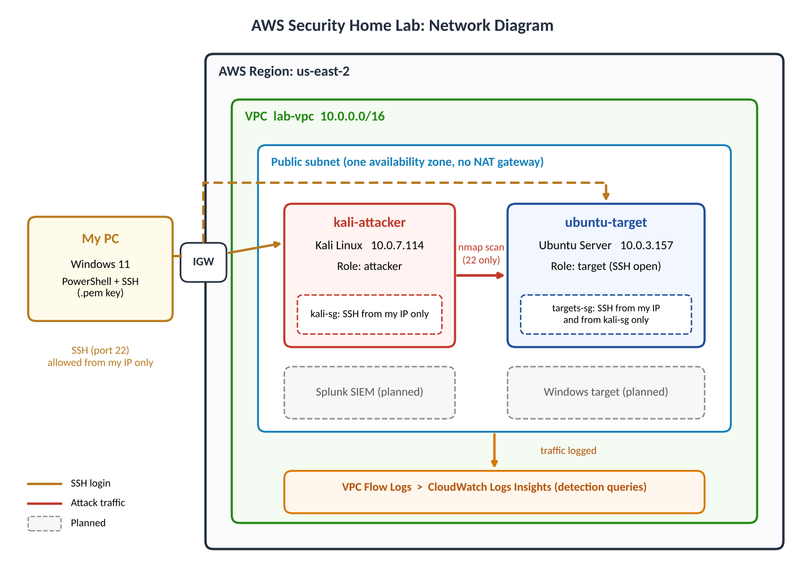
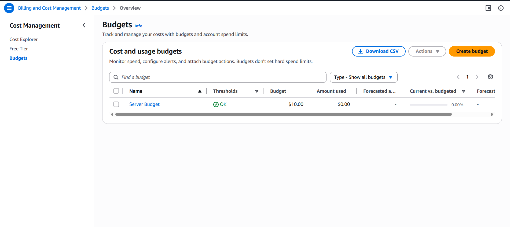
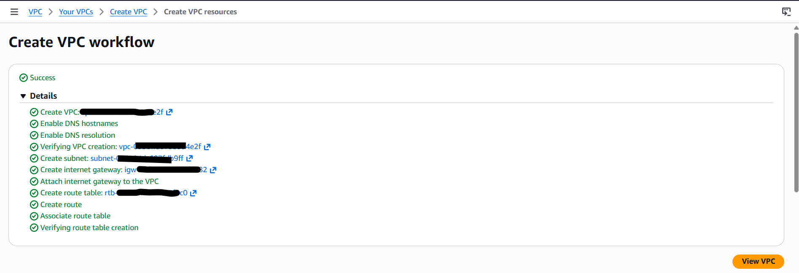
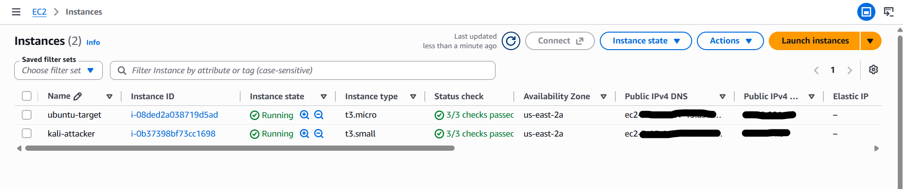
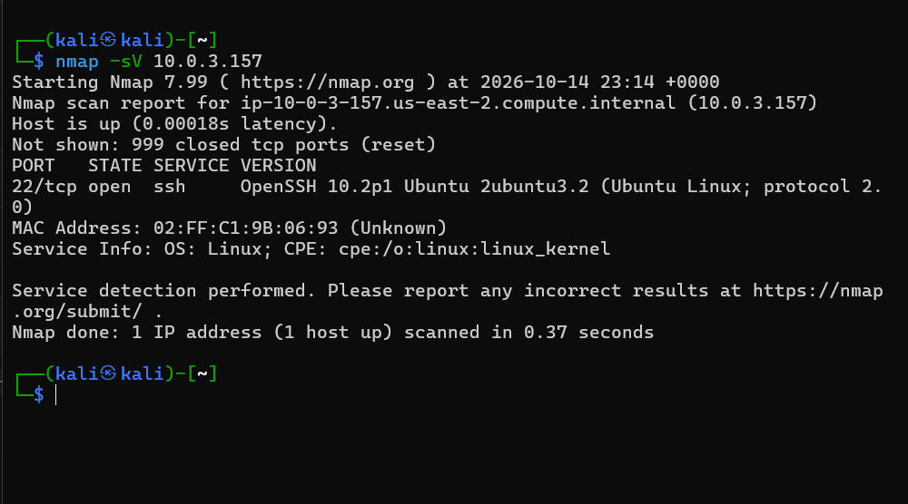
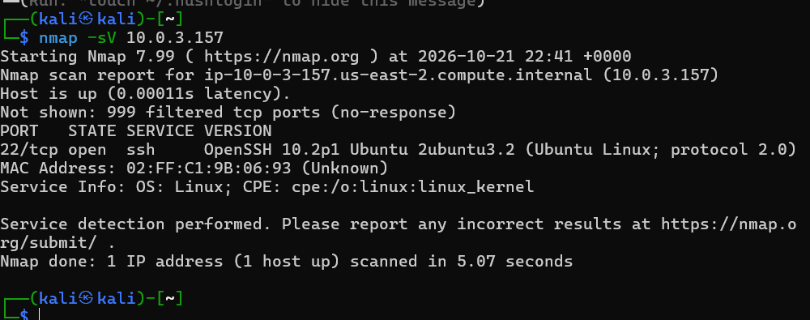

# AWS Security Home Lab

A small corporate-style network built in AWS where I attack my own machines, detect the activity in logs, fix the weaknesses, and attack again to confirm the fixes work.

**Status:** In progress
**Started:** October 2026
**Author:** Andrew Chigbu

## Goal

Practice the daily work of a SOC analyst in a safe environment: run an attack, find it in the logs, write an alert or rule, apply a fix, and retest. Everything is documented so each step can be repeated.

## Tools

| Purpose | Tool |
|---|---|
| Cloud platform | AWS (VPC, EC2, security groups, CloudTrail, VPC Flow Logs) |
| SIEM | Splunk |
| Attacker | Kali Linux |
| Targets | Ubuntu Server, Windows |
| Diagramming | draw.io |

## Network Diagram

*Add the diagram after the VPC and instances are built.*

## Safety Rules

- All attacks are run only against machines I own in this lab.
- Security groups allow inbound traffic only from my own IP address and from the attacker machine.
- No access keys, passwords, or account IDs are published in this repo.
- Instances are stopped or terminated when not in use, and a billing alert is set.
- Testing follows the AWS penetration testing policy (no denial-of-service attacks).

## Phase 1: Account Setup

- Enabled MFA on the root account
- Created a $10 monthly cost budget with an email alert
- Worked in one region (us-east-2) so nothing is left running elsewhere

**Notes / problems and fixes:**
- The IAM user I created had no console sign-in option in my console, so I used the root account with MFA for this lab. In a production account I would use IAM Identity Center or a dedicated admin user.
## Phase 2: Network (VPC)

- VPC CIDR: `10.0.0.0/16`
- One public subnet, no NAT gateway (to avoid cost)
- Access controlled with security groups

**Design decisions:**
- No Nat gateway, because it costs about $30 a month and isn't needed
- One subnet keeps the lab simple
- Two security groups:
-   kali-sg: SSH allowed only from my IP
-   targets-sg: SSH from my IP, and all traffic from kali-sg so attacks can reach targets

## Phase 3: Machines

| Machine | Role | OS | Notes |
|---|---|---|---|
| kali-attacker | Attacker | Kali Linux | t3.small |
| ubuntu-target | Linux server | Ubuntu Server | t3.micro |
| Target 2 | Windows host | Windows | |
| SIEM | Log collection | Ubuntu + Splunk | |

## Phase 4: Logging and Detection

- Log sources connected to Splunk: [Linux auth logs, Windows event logs, VPC Flow Logs, CloudTrail]
- [Describe how logs get to Splunk.]

## Phase 5: Attack, Detect, Fix, Retest

Repeat this section for each scenario.

### Scenario 1: Port scan

| Step | Details |
|---|---|
| Attack | nmap -sV against the target's private IP from Kali |
| What the logs showed | [Events, fields, and search used to find it] |
| Result before any fix | Port 22 open, 999 other ports closed |
| Detection | [Splunk search or alert written] |
| Fix | [Security group change or hardening applied] |
| Retest | [Result after the fix] |

### Scenario 2: SSH brute force

| Step | Details |
|---|---|
| Attack | |
| What the logs showed | |
| Detection | |
| Fix | |
| Retest | |

### Scenario 3: Windows failed logons

| Step | Details |
|---|---|
| Attack | |
| What the logs showed | |
| Detection | |
| Fix | |
| Retest | |

## Problems and Fixes

- Powershell path with spaces needed qoutes
- SSH "permission denied (publickey)": the Kali image uses the username kali, not ubuntu
- Ran a Linux ping command in PowerShell by mistake; learned to double check the prompt before running commands

## What I Learned

- [How the attacks appeared in the logs]
- [What a security group can and cannot stop]
- [What I would add next]

## Next Steps

- [ ] Add GuardDuty findings
- [ ] Build the same lab locally with pfSense
- [ ] Write more detection rules
